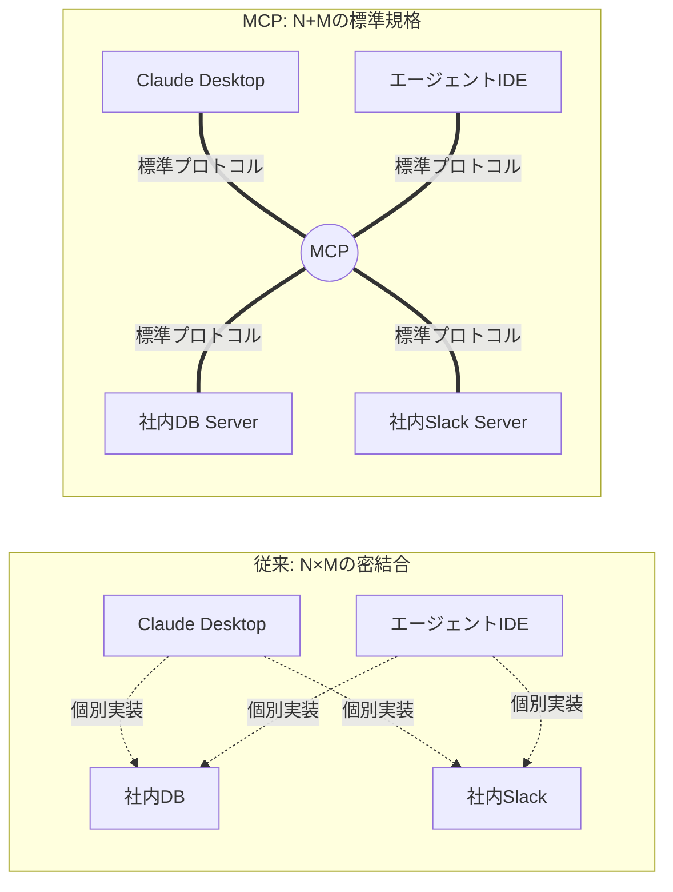

# MCP（Model Context Protocol）入門：LLMと社内データソース・ツールを標準仕様で接続するアーキテクチャ

## 1. 導入 (WHY)

社内システムとLLM（大規模言語モデル）を連携させる際、データベースの数値参照、Slack通知、チケット起票の自動化といった要件が多く挙がります。

しかし、従来のツール連携では、実装と運用の両面で次の3つの課題が生じがちです。

- **課題1: モデルやクライアントごとに連携コードを書き直す二重管理**  
  Webチャット、エディタ拡張機能、独自ポータルなど、利用するUIやモデルが変わるたびに関数定義やAPI呼び出しの接続コードを個別に実装する必要があり、保守コストが増加します。
- **課題2: 社内データへの直接アクセスに伴うセキュリティ境界の設計難易度**  
  LLMに付与する権限の範囲や、渡してよい社内データの境界について統一基準を設けにくく、安全なアクセス制御の設計に時間を要します。
- **課題3: 関数呼び出し・社内ナレッジ・定型プロンプトの管理の分断**  
  従来の仕組みは「関数の実行」に特化しており、社内規程ドキュメントの参照やチーム共通のプロンプトテンプレートの配布は、別の仕組みで管理せざるを得ませんでした。

こうした密結合の課題に対し、Anthropic社が2024年11月にオープン標準仕様として公開した規格が **Model Context Protocol（MCP）** です。

MCPは、ハードウェアにおけるUSB-Cのように、AIモデルと外部のツールやデータソースを接続する共通インターフェースを提供します。MCPサーバーを1つ構築すれば、対応するクライアントから統一仕様で安全にツールやデータを呼び出せます。

本稿では、MCPの基本仕様、従来のファンクションコーリングとの設計上の違い、およびPython公式SDKの高水準機能「MCPServer（旧FastMCP）」を用いた社内ツール連携サーバーの実装手順を解説します。

---

## 2. 本論 (WHAT & HOW)

### セクション1: MCPとは何か？〜Function Callingとのアーキテクチャ・設計思想の違い〜

> 💡 **用語解説: LLM（大規模言語モデル）**  
> 膨大なテキストを学習し、自然言語の対話やコード生成を行うAIモデルのこと。

> 💡 **用語解説: ファンクションコーリング**  
> LLM自身が状況を判断し、外部のプログラムやAPI関数を呼び出して結果を受け取る技術。

> 💡 **用語解説: MCP（Model Context Protocol）**  
> AIと外部ツールやデータを統一規格で安全に接続するためのオープンな通信規約。

#### 1. 「N×Mの密結合」から「N+Mの標準規格」へのシフト

従来のファンクションコーリングでは、接続対象のツール群（$N$個）と、利用するAIクライアントやモデル（$M$個）の間で、それぞれ固有のAPI仕様に合わせた接続コードが必要でした。そのため、管理対象の組み合わせは $N \times M$ 通りに増加します。



PCの周辺機器がUSB-Cに統一されて専用ケーブルが不要になったように、MCPを導入すると、AIクライアントは共通規格を通じて社内ツールへ接続できるようになります。社内システム側はMCPサーバーを1つ用意すれば、Claude DesktopやCursor、社内開発のAIポータルなど、あらゆる対応ホストから共通プロトコルで利用可能です。

#### 2. アーキテクチャの基本構成：Host・Client・Server

MCPは、次の3つのコンポーネントで構成されるクライアント・サーバーモデルです。

1. **MCP Host（ホスト）**:  
   ユーザーが直接操作するフロントエンドアプリケーション（Claude Desktop、IDE、社内Webチャットなど）。LLMとの対話制御と、ツール実行時のユーザー承認を統括します。
2. **MCP Client（クライアント）**:  
   Host内部に常駐し、各MCP Serverとの通信セッションを確立・維持する通信窓口です。
3. **MCP Server（サーバー）**:  
   社内データベース、API、ローカルファイルなどをラップし、標準化されたインターフェースを公開する軽量プログラムです。

#### 3. 通信プロトコルとトランスポート方式

MCPの基盤メッセージング規格は **JSON-RPC 2.0** です。トランスポート（通信路）には主に次の2種類が規定されています。

> 💡 **用語解説: JSON-RPC**  
> JSON形式のメッセージを用いて、遠隔のプログラムを呼び出す軽量な通信規約。

> 💡 **用語解説: stdio（標準入出力）**  
> プログラム同士がOSの標準入力と標準出力を通じてデータを送受信する通信方式。

- **stdio（標準入出力）**:  
  ローカルPC上でHostプロセスがServerプロセスをサブプロセスとして起動し、標準入出力経由で通信します。環境構築が容易で、ローカルファイルの操作や開発環境の検証に適しています。
- **SSE（Server-Sent Events）over HTTP**:  
  Web標準技術を使い、ネットワーク越しのサーバーと通信します。社内ネットワーク上の共有サーバーや共通APIコンテナを、複数ユーザーのクライアントからリモート接続する構成に向いています。

---

### セクション2: MCPサーバーの3大プリミティブを理解する

従来のファンクションコーリングは「関数の実行」に特化していましたが、MCPサーバーは以下の3つの機能（プリミティブ）を提供します。

| プリミティブ | 制御の主体 | 主な役割 | 社内ユースケースの例 |
| :--- | :--- | :--- | :--- |
| **Tools（ツール）** | モデル主導（Model-controlled） | 副作用を伴う関数の実行 | チケット起票、勤怠登録、DBデータ更新 |
| **Resources（リソース）** | アプリ/人間主導（Application-controlled） | 読み取り専用データの安全な参照 | 就業規則の参照、API仕様書の読込、ログ抽出 |
| **Prompts（プロンプト）** | ユーザー主導（User-controlled） | サーバー側で管理・配布する再利用可能な対話テンプレート | 新入社員オンボーディング、障害報告書作成 |

特に重要なのが「Resources」の分離です。LLMに更新や外部送信の実行権限を与えず、「必要な情報だけを安全にコンテキストへ注入する」という読み取り専用の境界線を明確に設定できます。

---

### セクション3: 【実践ハンズオン】MCPServerで作る社内社員検索＆勤怠確認サーバー

公式Python SDK（v2系）に含まれる高水準フレームワーク **MCPServer（旧FastMCP）** を使い、最小限の社内ツール連携サーバーを構築します。MCPServerでは、関数の型ヒント（`str` など）やdocstringからLLM向けのツール定義スキーマ（JSON Schema）が自動生成されるため、スキーマを手動で記述・保守する必要がありません。

> 💡 **コラム: SDK v1（FastMCP）から v2（MCPServer）への名称変更**  
> MCP公式Python SDKのバージョン2.0以降、従来の `FastMCP` クラスは `MCPServer`（`mcp.server.mcpserver`）へ正式に名称変更・統合されました。機能やデコレータの使い方は従来のFastMCPを踏襲しているため、既存のナレッジをそのまま活用できます。

#### 1. 前提環境の準備

長期運用を考慮し、現在アクティブサポート期間中である **Python 3.11 または 3.12** を使用します。

> ⚠️ **サポート期間（EOL）に関する注意**:  
> Python 3.10は2026年10月に公式サポートが終了（EOL）しています。新規の社内システムでは、セキュリティ修正が継続して提供されるPython 3.11（2027年10月EOL予定）またはPython 3.12（2028年10月EOL予定）以上をご利用ください。

仮想環境を作成し、必要なパッケージをインストールします。

```bash
# 仮想環境を作成して有効化
python3 -m venv .venv
source .venv/bin/activate

# MCP公式SDK（v2系・CLI機能付き）をインストール
pip install "mcp[cli]>=2.0.0"
```

#### 2. 最小構成サーバーの実装 (`server.py`)

外部データベース接続を不要にするため、インメモリのダミーデータを用いた社員検索サーバーを作成します。架空の「Example株式会社」を想定し、安全なダミーデータのみを配置します。

以下のコードを `server.py` として保存します。

```python
"""
社内情報連携 MCPサーバー (MCP SDK 2.x 実装例)
- 提供機能: 社員情報検索ツール (Tool), 社内規程リソース (Resource), オンボーディング質問 (Prompt)
"""
from mcp.server.mcpserver import MCPServer

# [1] MCPServerインスタンスの初期化
mcp = MCPServer("InternalCompanyServer")

# [2] セキュリティに配慮した架空の社内ダミーデータ定義
DUMMY_EMPLOYEES = [
    {
        "id": "EMP-001",
        "name": "山田 太郎",
        "department": "開発部",
        "email": "taro.yamada@example.com",
        "status": "在宅勤務",
    },
    {
        "id": "EMP-002",
        "name": "佐藤 花子",
        "department": "企画部",
        "email": "hanako.sato@example.com",
        "status": "オフィス出社",
    },
    {
        "id": "EMP-003",
        "name": "鈴木 一郎",
        "department": "情シス部",
        "email": "ichiro.suzuki@example.com",
        "status": "休暇中",
    },
]

DUMMY_REMOTE_WORK_POLICY = """
【Example株式会社 リモートワーク運用規程（ダミー抜粋）】
1. 原則週3日までの在宅勤務を認めます。
2. コアタイム（11:00〜15:00）は社内チャットツールに即座に応答できる状態を維持してください。
3. 社外での作業時は、社内VPNおよび指定端末の暗号化を必須とします。
""".strip()


# [3] ツール（Tools）の定義: LLMが自律的に社員情報を検索するアクション
@mcp.tool()
def search_employee(keyword: str) -> str:
    """
    氏名または部署名から社内メンバーの所属・メールアドレス・本日の勤務状態を検索します。

    Args:
        keyword: 検索したい氏名（例: 山田）または部署名（例: 開発部）
    """
    # 検索キーワードに一致する社員をフィルタリング
    results = [
        emp for emp in DUMMY_EMPLOYEES
        if keyword in emp["name"] or keyword in emp["department"]
    ]
    if not results:
        return f"キーワード '{keyword}' に一致する社員は見つかりませんでした。"

    # LLMが読み取りやすい形式にテキストを整形
    formatted_lines = []
    for emp in results:
        formatted_lines.append(
            f"- 社員ID: {emp['id']} / 氏名: {emp['name']} / 部署: {emp['department']} / "
            f"連絡先: {emp['email']} / 本日のステータス: {emp['status']}"
        )
    return "\n".join(formatted_lines)


# [4] リソース（Resources）の定義: 読み取り専用の社内ドキュメントを提供
@mcp.resource("internal://policy/remote-work")
def get_remote_work_policy() -> str:
    """社内リモートワーク運用規程のテキストを取得します。"""
    # 読み取り専用ドキュメントを返却
    return DUMMY_REMOTE_WORK_POLICY


# [5] プロンプト（Prompts）の定義: 定型ワークフロー用のプロンプトテンプレート
@mcp.prompt()
def onboarding_inquiry(employee_name: str) -> str:
    """新入社員向けの初回アクション確認プロンプトを生成します。"""
    # テンプレート文字列を組み立てて返却
    return (
        f"私は新入社員の{employee_name}です。"
        "当社のリモートワーク規程（internal://policy/remote-work）を確認し、"
        "本日中に設定すべきPC環境およびチャットでの初回連絡事項を3点で要約してください。"
    )


# [6] エントリポイント: stdioトランスポートでサーバーを起動
if __name__ == "__main__":
    # 標準入出力経由のメッセージ待機ループを開始
    mcp.run()
```

#### 3. 起動と動作確認

実装したサーバーの動作確認には、公式の開発用インスペクター（MCP Inspector）の **CLI モード（`--cli` オプション）** が利用できます。ブラウザを起動せず、ターミナル上のコマンドから直接ツールやリソースの応答を検証できます。

```bash
# 1. 公開されているツール一覧（スキーマ）の確認
npx @modelcontextprotocol/inspector --cli python server.py --method tools/list

# 2. Toolsの実行: search_employee に引数を渡して社員情報を検索
npx @modelcontextprotocol/inspector --cli python server.py \
  --method tools/call \
  --tool-name search_employee \
  --tool-arg keyword=開発部

# 3. Resourcesの取得: 社内リモートワーク運用規程を読み込み
npx @modelcontextprotocol/inspector --cli python server.py \
  --method resources/read \
  --uri internal://policy/remote-work

# 4. Promptsの実行: 新入社員向けプロンプトテンプレートを生成
npx @modelcontextprotocol/inspector --cli python server.py \
  --method prompts/get \
  --prompt-name onboarding_inquiry \
  --prompt-arg employee_name=田中
```
<details>
  <summary>ブラウザ上でインスペクター（MCP Inspector）の利用も可能です。</summary>

```bash
# MCP Inspectorを起動してブラウザから対話テスト
npx @modelcontextprotocol/inspector python server.py
```

ブラウザ上でインスペクター（`http://localhost:xxxx`）が開き、サーバーが公開する能力を個別にテストできます。

- **Toolsタブ**: `search_employee` に引数 `{"keyword": "開発部"}` を指定して実行し、社員データが返却されることを確認します。
- **Resourcesタブ**: `internal://policy/remote-work` を選択し、規程テキストが表示されることを確認します。
- **Promptsタブ**: `onboarding_inquiry` に任意の名前を入力し、整形されたプロンプトが生成されることを確認します。
</details>

<details>
  <summary>Claude Desktopから連携する場合は、設定ファイル（`claude_desktop_config.json`）に以下の記述を追加します。</summary>

Claude Desktopから連携する場合は、設定ファイル（`claude_desktop_config.json`）に以下の記述を追加します。

```json
{
  "mcpServers": {
    "internal-company": {
      "command": "/絶対パス/.venv/bin/python",
      "args": ["/絶対パス/server.py"]
    }
  }
}
```
</details>

> ⚠️ **開発時の注意点: stdio通信における標準出力の汚染**  
> stdioトランスポートでは、標準出力（stdout）がJSON-RPCメッセージの通信路として使われます。コード内で `print()` などの標準出力を実行すると、JSON-RPCメッセージが破損して通信エラーの原因になります。デバッグ出力を行う場合は、必ず `sys.stderr.write()` を使うか、標準の `logging` モジュール（デフォルトでstderrへ出力）を使用してください。

---

### セクション4: 社内導入におけるセキュリティと運用のベストプラクティス

社内環境でMCPサーバーを運用する際は、次の3点に留意して設計します。

1. **最小権限の原則（Read-onlyの優先）**:  
   データの参照のみを目的とする場合は、更新系「Tools」ではなく読み取り専用「Resources」として公開します。変更を伴うツールを提供する場合は、Host側の機能でユーザーの実行確認を挟む運用を推奨します。
2. **機密情報・個人情報のマスキング**:  
   MCPサーバーはデータソースとLLMの間のフィルターとして機能します。データベースの全項目をそのまま渡さず、サーバー側で不要な個人情報や機密カラムを除外してからLLMへ渡す構成にします。
3. **リモート接続時の認証とアクセス制御**:  
   ネットワーク経由（SSE over HTTP）でMCPサーバーを公開する場合は、社内のID管理基盤（OAuth 2.0 / OIDC等）やリバースプロキシを介し、利用可能なツールやデータへのアクセス権限を制御します。

---

## 3. まとめ (NEXT STEP)

MCPは、AIクライアントと社内データソース・ツール間の接続規格を統一し、拡張性と保守性を両立させるアーキテクチャです。

### 要点の整理
- **疎結合化（N+Mの統合）**: ツールとクライアント間の個別接続コードを排除し、単一の標準プロトコルで接続を共通化する。
- **3大プリミティブの分離**: 関数の実行（Tools）、安全なデータ参照（Resources）、定型ワークフロー（Prompts）を役割に応じて分離管理できる。
- **MCPServerによる迅速な実装**: Pythonのデコレータと型ヒントにより、スキーマの手動管理なしでサーバーを構築できる。

### 次のアクション
1. **ローカル環境でのMCPServer検証**:  
   本稿の `server.py` を手元の環境で実行し、MCP Inspectorからツールやリソースの呼び出しを試す。
2. **社内データソースの棚卸しとResources設計**:  
   社内WikiやAPI仕様書など、まずは参照専用でAIに読み込ませたいデータを特定し、小規模なプロトタイプサーバーを設計する。

詳細な仕様および最新のクライアント実装については、[Model Context Protocol 公式ドキュメント](https://modelcontextprotocol.io) を参照してください。
